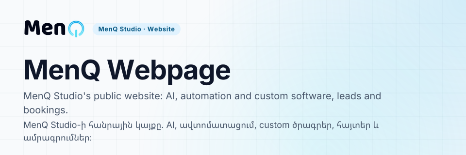

<!-- FRONT:START -->

<picture><source media="(max-width: 600px) and (prefers-color-scheme: dark)" srcset="docs/assets/front/cover-narrow-dark.svg"><source media="(max-width: 600px)" srcset="docs/assets/front/cover-narrow-light.svg"><source media="(prefers-color-scheme: dark)" srcset="docs/assets/front/cover-dark.svg"></picture>

<b>Start here</b> · [Project context](PROJECT_CONTEXT.md) · [Documentation index](DOCUMENTATION_INDEX.md) · [Roadmap](ROADMAP.md) · [Design platform adoption](docs/menq-standard/README.md)

| | |
| :-- | :-- |
| **What it is** | The public business website of MenQ Studio with lead and booking intake and an invite-only admin |
| **Who it serves** | Businesses looking for AI, automation and custom software; MenQ's own team in the admin |
| **State** | Implementation merged and green; design platform adoption M2-pilot (see Status below) |
| **Stack** | Next.js 16, React 19, TypeScript, Prisma, Tailwind CSS, MenQ brand tokens |

<b>Հայերեն</b>

| | |
| :-- | :-- |
| **Ինչ է** | MenQ Studio-ի հանրային բիզնես կայքը՝ հայտերի և ամրագրումների ընդունմամբ և միայն հրավերով admin-ով |
| **Ում համար** | AI, ավտոմատացում և custom ծրագրեր փնտրող բիզնեսների. admin-ում՝ MenQ-ի թիմի |
| **Վիճակ** | Իրականացումը merge արված է և կանաչ. դիզայն հարթակի adoption՝ M2-pilot (տես ներքևի Status-ը) |
| **Տեխնոլոգիաներ** | Next.js 16, React 19, TypeScript, Prisma, Tailwind CSS, MenQ բրենդի token-ներ |

MenQ Studio · Website · repository front page standard v1
<!-- FRONT:END -->

# MenQ Webpage

> **HY**  
> MenQ-ի public business website-ը և lead-generation product-ը։  
> **EN**  
> MenQ's public business website and lead-generation product.

## Status / Կարգավիճակ

- **Implementation:** merged and GREEN / merge արված և GREEN
- **Design Platform authority:** Locked `D-025`
- **Implementation PR:** `#1`
- **Implementation merge:** `56c991bfca19b9b5b16860a94e8fe3399f76b5dd`
- **Validated head:** `bfae33680ec408557516d4f9d581a30cc2137cfd`
- **Adoption maturity:** `M2-pilot` (Owner approval 2026-10-08)
- **Languages:** Armenian + English canonical; Russian product locale
- **Owner:** Gevorg Ohanyan

## Purpose / Նպատակ

**HY:** Website-ը ներկայացնում է MenQ Studio-ի AI, automation և custom-software ծառայությունները, ընդունում է leads/bookings և ապահովում է invite-only administration։

**EN:** The website presents MenQ Studio's AI, automation, and custom-software services, accepts leads and bookings, and provides invite-only administration.

## Architecture / Ճարտարապետություն

**HY:** Repository-ն governed consumer է MenQ Standard-ի և Locked D-025 MenQ Design Platform-ի նկատմամբ։ Shared design contracts-ը product-neutral են, իսկ brand expression-ը, marketing composition-ը, content-ը, routes-ը և business logic-ը product-local են։

**EN:** The repository is a governed consumer of MenQ Standard and the Locked D-025 MenQ Design Platform. Shared design contracts remain product-neutral, while brand expression, marketing composition, content, routes, and business logic remain product-local.

## Canonical navigation / Canonical նավիգացիա

- [`PROJECT_CONTEXT.md`](PROJECT_CONTEXT.md)
- [`AI_WORKING_CONTEXT.md`](AI_WORKING_CONTEXT.md)
- [`COLLABORATION_STYLE.md`](COLLABORATION_STYLE.md)
- [`DOCUMENTATION_INDEX.md`](DOCUMENTATION_INDEX.md)
- [`DECISION_INDEX.md`](DECISION_INDEX.md)
- [`DECISIONS.md`](DECISIONS.md)
- [`ROADMAP.md`](ROADMAP.md)
- [`CHANGELOG.md`](CHANGELOG.md)
- [`NEXT_CHAT_HANDOFF.md`](NEXT_CHAT_HANDOFF.md)
- [`docs/menq-standard/README.md`](docs/menq-standard/README.md)

## Human–AI rule / Human–AI կանոն

**HY:** Մարդը միտք է բերում։ AI-ն օգնում է։ Մարդը որոշում է։ Repository-ն պահպանում է truth-ը։

**EN:** Humans bring ideas. AI assists. Humans decide. The repository preserves truth.

<!-- END: MENQ_WEBPAGE_README -->
